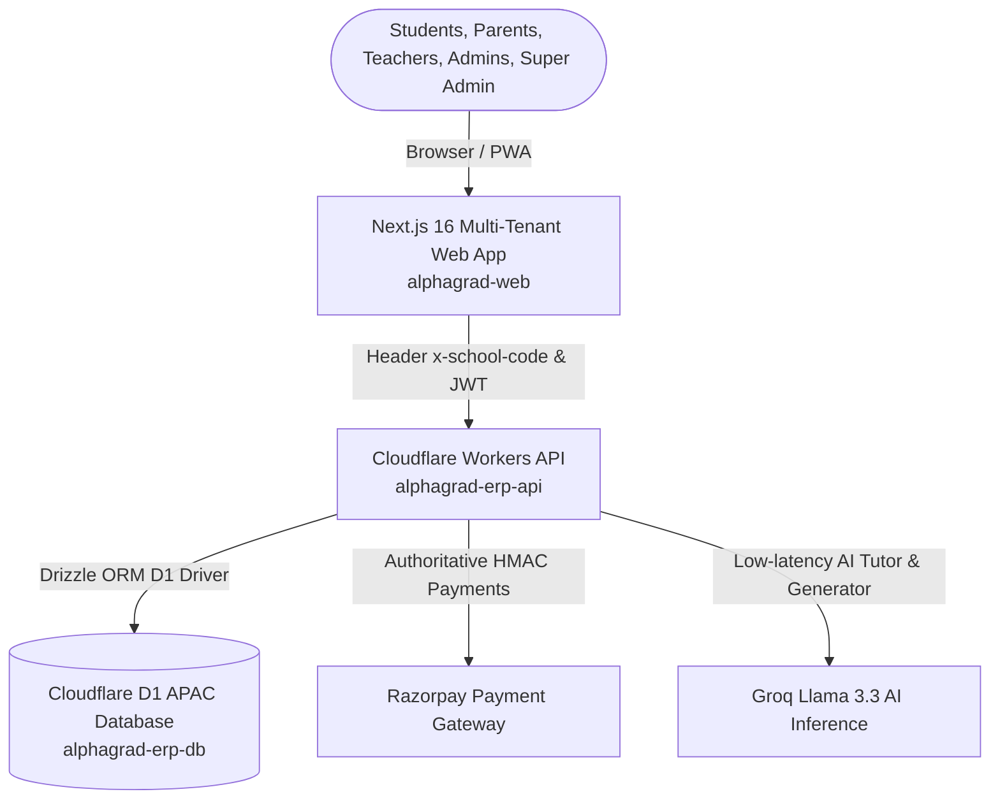

# AlphaGrad-ERP — Autonomous Multi-Tenant Coaching & School ERP Platform

Production-grade, highly scalable multi-tenant Enterprise Resource Planning (ERP) platform built on **Cloudflare Workers**, **Cloudflare D1**, and **Next.js 16 (React 19 & Turbopack)**.

---

## 1. System Overview

AlphaGrad-ERP allows the platform owner to:
1. **Host Multiple Independent Schools & Coaching Centers** on a single serverless infrastructure.
2. **Super Admin Governance (`/super-admin`)**:
   - Register new schools / institutes with a unique slug/code (e.g. `dps-delhi`, `resonance`, `zenith`).
   - Assign initial institute administrator credentials (`Alpha1000` or custom).
   - **Modular Feature Matrix**: Selectively toggle which of the 20 ERP modules each school can access.
   - Real-time feature gating: When a module is turned off by Super Admin, it is immediately hidden from the school's navigation and protected by the Cloudflare Worker API.
3. **Dedicated School Portal (`/:schoolCode/login`)**:
   - Branded login with school name, logo, and active capabilities.
   - Role-based automatic redirection:
     - School Administrators → `/:schoolCode/admin`
     - Subject Teachers → `/:schoolCode/teacher`
     - Students & Parents → `/:schoolCode/portal` (Mobile-first PWA)

---

## 2. Platform Architecture



---

## 3. Seed Credentials & Platform Access

### Super Administrator
- **Login URL:** `/super-admin/login` (or `https://alphagrad-web.vercel.app/super-admin/login`)
- **Email:** `superadmin@alphagrad.in`
- **Password:** `AlphaGrad@Super2026`
- **Privilege:** Unlimited platform governance, school registration, feature toggles, credential resets.

### Adding Your First School
1. Log in to the Super Admin Console at `/super-admin/login`.
2. Click **Add New School / Institute**.
3. Provide School Name, City, Unique School Code (e.g. `resonance`, `zenith`), and Initial Admin credentials.
4. Select the enabled feature suite (Academics, Attendance, Fees, CBT Tests, AI Tutor, etc.).
5. The school can immediately access their custom portal at `/:schoolCode/login`!

---

## 4. Live Production Deployments

- **Frontend ERP Web App:** [https://alphagrad-web.vercel.app](https://alphagrad-web.vercel.app)
  - Custom Domain Target: `erp.novaxai.in` (add CNAME `cname.vercel-dns.com` in Cloudflare DNS for `novaxai.in`)
- **Backend Worker API:** [https://alphagrad-erp-api.divyansh-shukla.workers.dev](https://alphagrad-erp-api.divyansh-shukla.workers.dev)
- **GitHub Repository:** [https://github.com/ivynsh1512/AlphaGrad-ERP](https://github.com/ivynsh1512/AlphaGrad-ERP)
- **Cloudflare D1 Database:** `alphagrad-erp-db` (ID: `3b19d090-bc2c-4566-a3be-0b1d1441c095`, APAC)
- **Active Tables:** 51 relational tables with strict row-level `school_id` tenant isolation.

---

## 5. Custom Domain Setup for `erp.novaxai.in`

To map `erp.novaxai.in` directly to the deployed web app:
1. In Cloudflare DNS for `novaxai.in`, add a **CNAME** record:
   - Type: `CNAME`
   - Name: `erp`
   - Content: `cname.vercel-dns.com`
   - Proxy status: DNS only (or Proxied)
2. In Vercel Project Settings (`alphagrad-web`):
   - Navigate to **Settings > Domains**
   - Add `erp.novaxai.in`
   - Vercel automatically issues and provisions the SSL certificate.

---

## 5. Local Development Quickstart

### 1. Cloudflare Worker API (`alphagrad-api`)
```bash
cd alphagrad-api
npm install
npm run dev
```
Starts locally at `http://127.0.0.1:8787`.

### 2. Next.js Web Application (`alphagrad-web`)
```bash
cd alphagrad-web
npm install
npm run dev
```
Starts locally at `http://localhost:3000`.
- Super Admin: `http://localhost:3000/super-admin`
- School Portals: `http://localhost:3000/:schoolCode/login`
